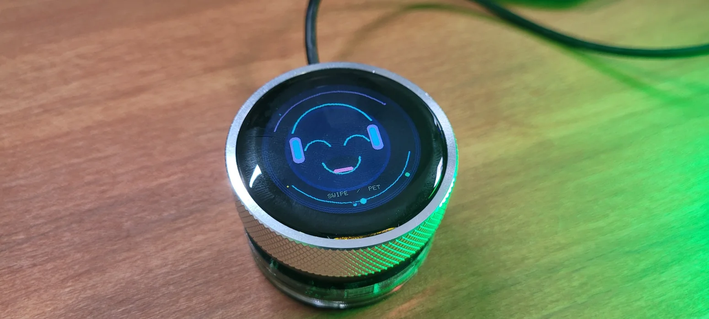
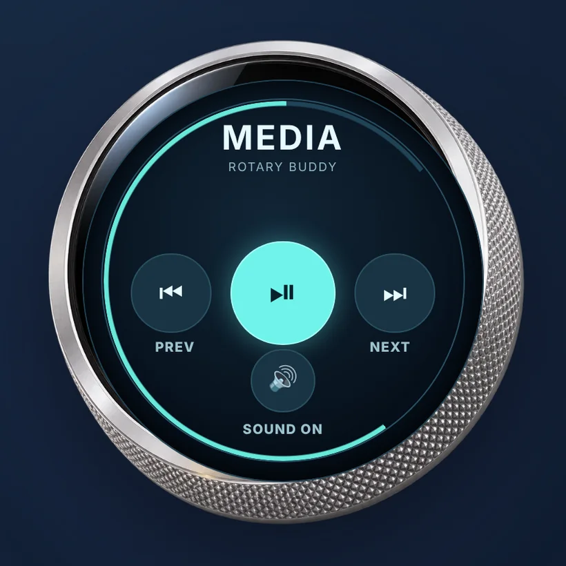
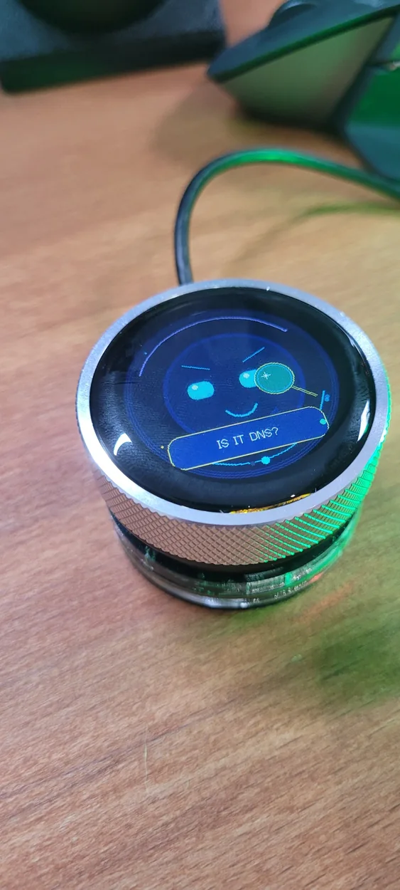
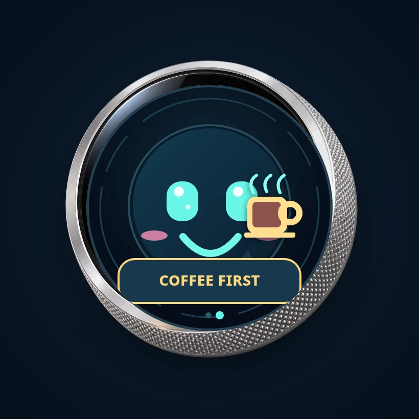

# CrowPanel Rotary Buddy

A small media controller that turns into an expressive desktop companion when you are not using it. Built for the **Elecrow CrowPanel 1.28-inch ESP32-S3 rotary display**, with a 240 × 240 circular touchscreen and USB HID media keys.

**[Open the website and install firmware](https://crowpanel-rotary-buddy.lepczynski.it/)** · [Source code](https://github.com/lepczynski-cloud/CrowPanel-Rotary-Buddy) · [YouTube](https://www.youtube.com/@WojciechLepczynski) · [Blog](https://lepczynski.it/)

  
  
  

Real device photographs on the left and right. The Media interface in the middle is an illustration of the on-device controls.

Turn the dial to change volume, press it to play or pause, or touch the screen to skip tracks and mute sound. Swipe sideways and it becomes Buddy, a little animated character that reacts when you tap or pet it, says silly things and eventually falls asleep.

The current firmware has **113 expression/effect states and 135 short captions**. New moods include AI prompting, code review, on-call, packet loss, safe deployments and cloud operations. These are *visual jokes*, not actual AI processing, network monitoring, background services or commands run on your computer. Buddy now also avoids repeating the exact same randomly chosen caption on consecutive selections.

There is **no desktop application, Bluetooth pairing, account, cloud backend or internet connection needed for normal use**. The computer sees a standard USB HID consumer-media controller. Media key support depends on the host OS and player; Windows, macOS and Linux are supported in principle.

## Two modes

| Media | Buddy |
| --- | --- |
| Previous, Play/Pause, Next and Mute on large touch targets. An animated local volume estimate shows the dial's recent changes. | Animated expressions, blinks, props, hats, short speech bubbles, gentle petting reactions, idle animation and sleep. |

 

Illustrative screen previews, not photographs.

**Controls:** Rotate to adjust volume; short press to play or pause; swipe horizontally to change screens; swipe downward on Buddy to pet it; tap Buddy for a random mood or joke. Tapping media controls sends USB media keys, but playful Buddy touches never do. The media screen changes to Buddy after 30 seconds without interaction. Buddy begins sleeping after five minutes and wakes when you interact again. Both intervals are configurable.

A few current captions: `COFFEE FIRST`, `IS IT DNS?`, `VERIFY THE OUTPUT`, `HUMAN IN THE LOOP`, `CHECK THE DIFF`, `PAGER AGAIN?`, `PACKET LOST!`, `CANARY FIRST`, `CLOUD BILL AGAIN` and `ROLLBACK READY?`.

**Limitations:** USB HID cannot read the computer's exact volume, playback status or mute state. The screen's volume percentage and mute symbol are local estimates based on actions sent from the dial. They may differ from settings changed on the computer itself.

## Install without Arduino IDE or PlatformIO

The website always serves the **latest successfully compiled firmware for the production branch**, built directly from the source by Cloudflare Pages.

1. Visit **https://crowpanel-rotary-buddy.lepczynski.it/** using Chrome or Edge on a computer with a USB data cable.
2. Connect the correct **Elecrow CrowPanel 1.28-inch ESP32-S3 rotary display**. To enter flash mode, hold BOOT, briefly press RESET, then release BOOT.
3. Choose **Factory install** for a new device or recovery, or **Update firmware** if you have the same partition layout already installed.
4. Select the correct serial port in the ESP Web Tools dialog and follow the instructions. Press RESET afterwards if necessary.

Factory installation writes a merged firmware image beginning at offset `0x0`. The update image writes only the application at `0x10000` and can preserve settings if the partition layout has not changed and you do **not** select *Erase device*. Flashing the wrong board may prevent it from working, so the manifest is restricted to ESP32-S3 and this project targets only the specified CrowPanel hardware.

The device may briefly disappear from the serial port list when the app boots as a USB media device. That is normal.

## Automatic Cloudflare Pages builds, without GitHub Actions

Every push to `main` starts one Cloudflare Pages build. It runs the C++ and website tests, compiles ESP32-S3 firmware with PlatformIO, merges the factory image with esptool, generates the update binary, validates SHA-256 checksums and both ESP Web Tools manifests, and deploys the site and firmware together. If the build fails, Cloudflare retains the previous successful deployment.

One-time Cloudflare Pages configuration:

| Setting | Value |
| --- | --- |
| Git repository | `lepczynski-cloud/CrowPanel-Rotary-Buddy` |
| Production branch | `main` |
| Framework preset | `None` |
| Build command | `bash scripts/build_pages.sh` |
| Output directory | `web` |
| Root directory | Repository root, default |
| Build system | `v3` |
| Custom domain | `crowpanel-rotary-buddy.lepczynski.it` |

There are no GitHub Actions, releases to upload manually, or separate `gh-pages` branches. Cloudflare's build environment provides Python and Node.js. The firmware platform and libraries are deliberately version-controlled in `platformio.ini` so changes to the build environment do not silently change hardware behaviour. Dependencies used by the build helper are in `tools/requirements-build.txt`.

The browser interface uses [ESP Web Tools](https://esphome.github.io/esp-web-tools/). It requires HTTPS and a compatible Web Serial implementation. The website itself is static; the installer only needs a browser, a USB connection and the published firmware files.

## Develop or customize

PlatformIO source files are in `src/main.cpp` and `include/`. `include/Config.h` controls things such as sleep time, automatic mode switching, screen brightness and volume sensitivity. Expressions and captions live in `include/BuddyBrain.h`; their drawing code lives in `include/BuddyGraphics.h`.

You can build locally if you prefer: `pio run -e crowpanel-rotary`. Windows helper scripts `BUILD_WINDOWS.bat` and `FLASH_WINDOWS.bat` are included for local developer use, but are not required to use the website installer.

The Cloudflare build runs host C++ tests (including gesture safety, mood rendering, random caption constraints and media controls), the website's manifest tests and the actual PlatformIO build. It also attempts to fetch genuine screenshots for other project cards on the site. Those images are optional and do not affect flashing.

## Other projects

- [ESP32 Admin Pocket Toolkit](https://esp32-admin-toolkit.lepczynski.it/): offline networking and sysadmin utilities on a small touchscreen.
- [ESP32 PC Control Deck](https://github.com/lepczynski-cloud/ESP32-PC-Control-Deck): hardware PC stats and a USB-connected host bridge.
- [M5Stack Touch Control Deck](https://m5stack-touch-control-deck.lepczynski.it/): Bluetooth media controls and shortcuts.
- [Online Admin Toolkit](https://admintoolkit.lepczynski.it/): browser-based network, Linux and other utilities.
- [More open-source projects](https://github.com/lepczynski-cloud) · [YouTube channel](https://www.youtube.com/@WojciechLepczynski) · [Blog](https://lepczynski.it/)

## License

MIT. Created by [Wojciech Lepczyński](https://lepczynski.it/). The hardware belongs to its manufacturer, and third-party build libraries retain their own licenses. No hosted model or AI API is used by the firmware.
